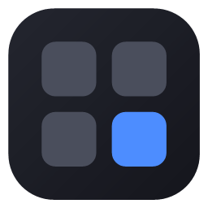
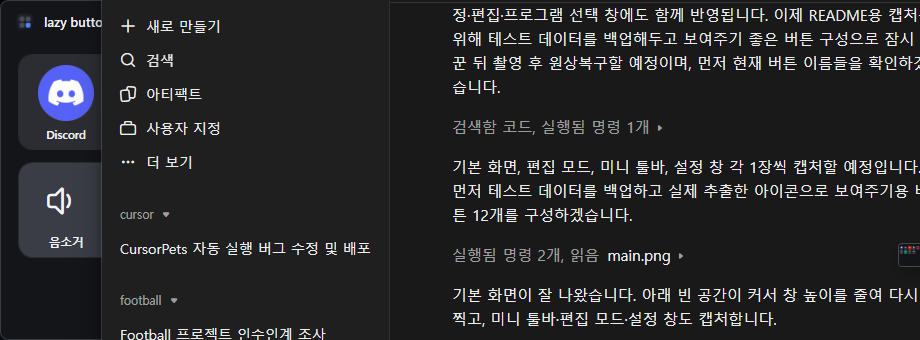
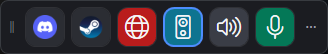
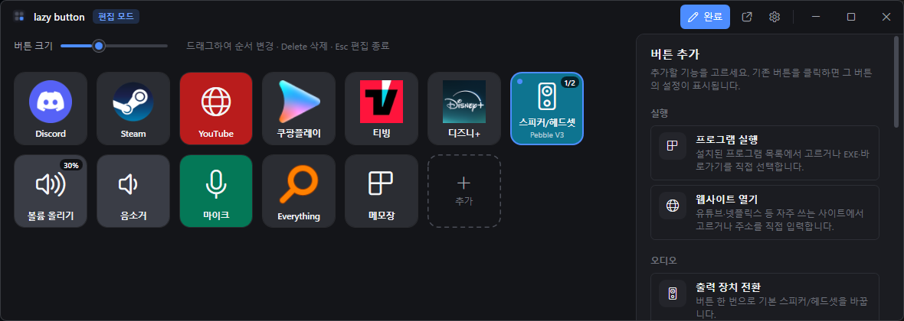
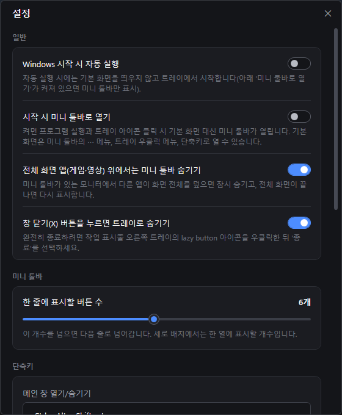
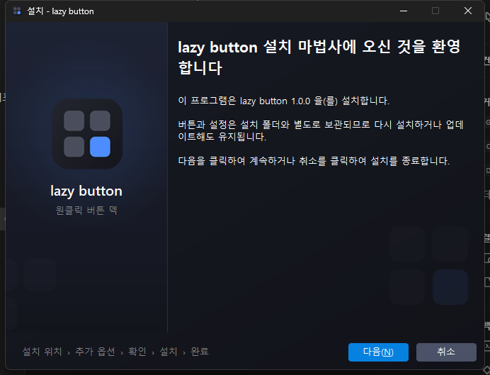
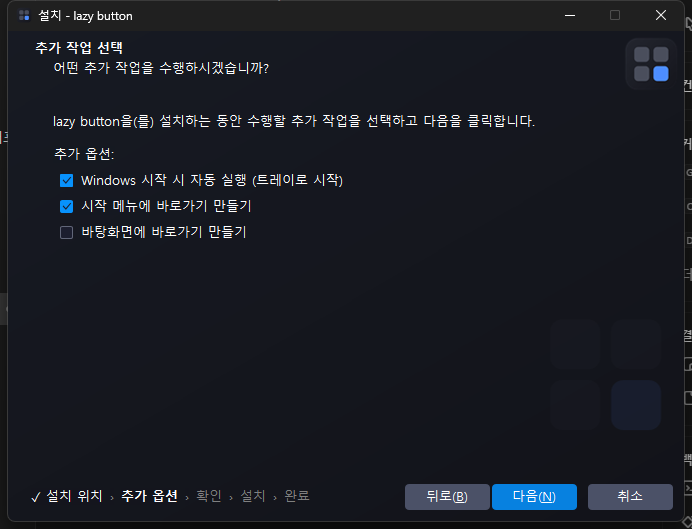

# lazy button

**자주 쓰는 프로그램·사이트·오디오 조작을 버튼 하나로.** 
Windows용 가상 스트림 덱입니다.

 

  

## 이런 걸 할 수 있어요

| | |
|---|---|
| 🚀 **프로그램 실행** | 설치된 프로그램 목록(Steam 방식)에서 골라 한 번에 여러 개 추가. 아이콘은 자동으로 가져옵니다. |
| 🌐 **웹사이트 열기** | 유튜브·넷플릭스·쿠팡플레이·티빙·디즈니+ 등 인기 사이트를 골라서 추가하거나 주소를 직접 입력. |
| 🔊 **출력 장치 전환** | 버튼 한 번으로 스피커 ↔ 헤드셋 전환. 지금 쓰는 장치가 버튼에 표시됩니다. |
| 🎚️ **볼륨·음소거** | 볼륨 올리기/내리기/지정, 음소거. 현재 볼륨(%)이 버튼에 바로 보입니다. |
| 🎙️ **마이크 음소거** | 회의·게임 중 마이크를 바로 끄고 켜기. 꺼져 있으면 빨간 테두리로 표시. |
| ⏯️ **미디어 조작** | 재생/일시정지, 다음·이전 곡 (Windows 미디어 컨트롤을 지원하는 앱). |

## 미니 툴바

화면 한쪽에 작게 띄워 두고 쓰는 도구 모음입니다. 원하는 버튼만 골라 담을 수 있고, **게임·영상 같은 전체 화면(전체 창 모드 포함) 앱 위에서는 자동으로 숨겨집니다.**

  

- 한 줄에 표시할 버튼 수, 가로/세로, 크기, 항상 위를 설정할 수 있어요.
- 놓아 둔 자리가 고정돼서 버튼이 늘어나도 화면 밖으로 밀려나지 않습니다.
- `⋯` 메뉴에서 기본 화면 열기·숨기기·설정·순서 변경을 할 수 있어요.

## 편집 모드

평소에는 버튼을 실수로 옮기거나 지울 수 없고, **편집 모드에서만** 추가·수정·순서 변경·삭제가 됩니다. 버튼을 끌어서 원하는 자리에 놓으면 됩니다.

  

## 설정

  

- **Windows 시작 시 자동 실행** (트레이에서 조용히 시작)
- **시작 시 미니 툴바로 열기**
- 전체 화면 앱 위에서 미니 툴바 숨기기, 창 닫기(X) 시 트레이로 숨기기
- 전역 단축키 (기본: `Ctrl + Alt + Shift + L` 로 창 열기/숨기기)
- 자동 업데이트 확인, 데이터 폴더 열기·백업

## 설치

1. 이 저장소의 Releases 에 등록된 설치 파일(**LazyButton-Setup.exe**)을 실행합니다.
2. 설치 위치와 옵션(자동 실행 · 시작 메뉴 · 바탕화면 바로가기)을 고르고 설치합니다. 관리자 권한은 필요 없습니다.

  
  

> [!NOTE]
> 개인 프로젝트라 코드 서명 인증서가 없습니다. 실행할 때 **"Windows의 PC 보호"** 창이 뜨면 **추가 정보 → 실행**을 눌러 주세요.

## 업데이트

새 버전이 나오면 앱이 알려 줍니다. **업데이트** 버튼만 누르면 내려받기 → 파일 확인(SHA-256) → 설치 → 다시 실행까지 자동으로 진행되고, **버튼과 설정은 그대로 유지됩니다.** 설치 도중 문제가 생기면 이전 버전으로 되돌린 뒤 다시 실행합니다.

## 데이터와 제거

- 버튼·아이콘·설정은 `%AppData%\LazyButton` 에 저장되고 자동으로 백업됩니다. 다시 설치하거나 업데이트해도 지워지지 않습니다.
- 제거는 **Windows 설정 → 앱 → 설치된 앱 → lazy button** 에서 할 수 있습니다. 제거할 때 사용자 데이터를 함께 지울지 물어보며, 기본값은 **남겨 두기**입니다.

## 요구 사항

- Windows 10 (버전 2004 이상) 또는 Windows 11, 64비트
- 별도 런타임 설치 필요 없음 (.NET 포함)
